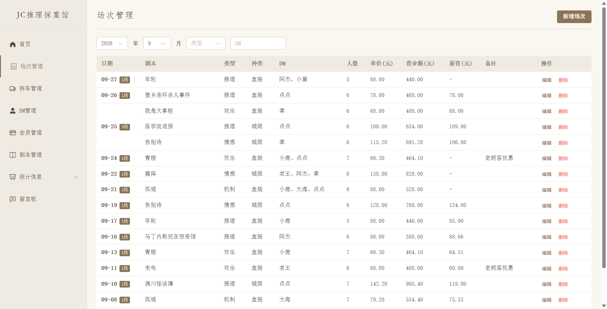
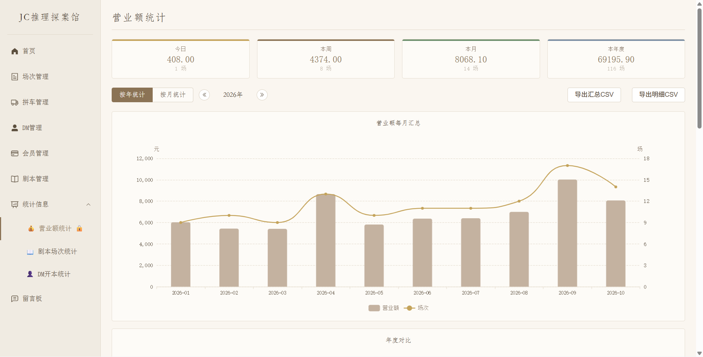
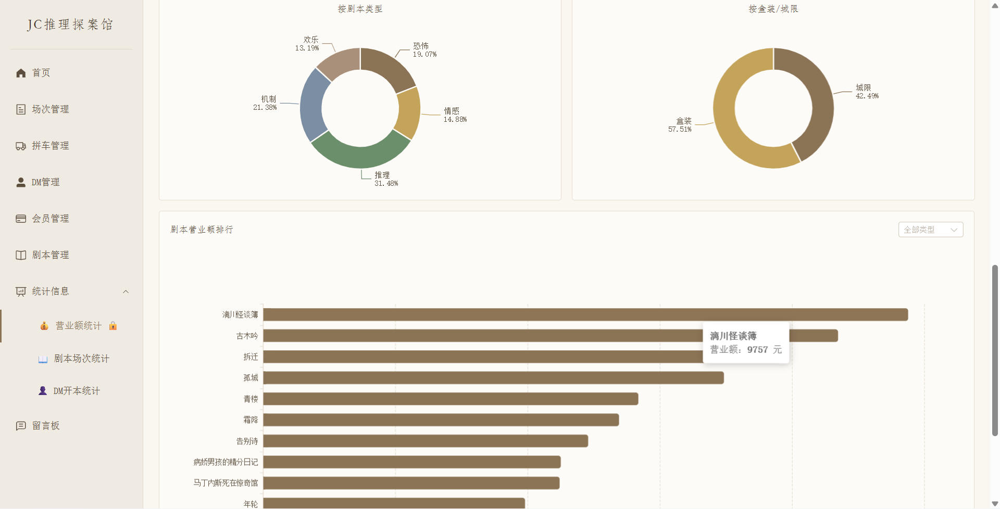
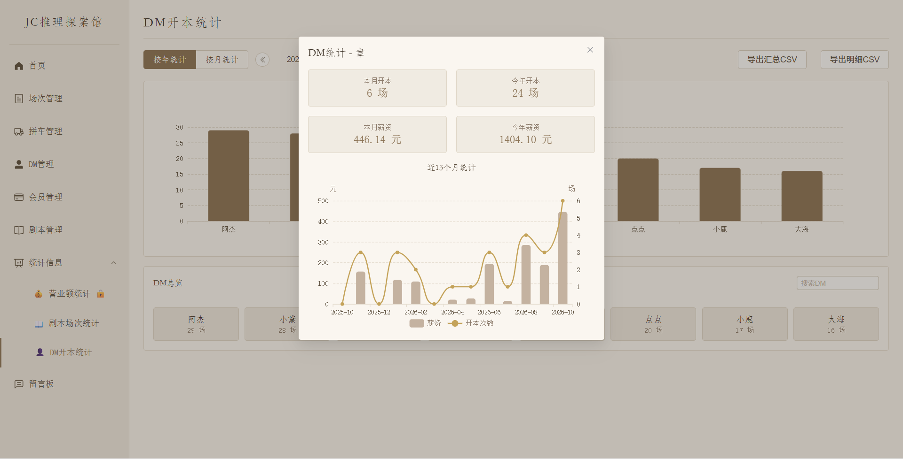

# 点小点剧本杀店铺管理系统

## 项目介绍

点小点剧本杀店铺管理系统是一款面向剧本杀店铺的本地管理工具，把开本记录、剧本资料、DM开本统计和会员储值集中到一个系统中，方便记录与查询，另外提供统计数据的可视化展示，可以方便店家了解店铺经营状况，辅助个性化进新本等等，减少繁琐的统计工作和人工算账等重复整理。

适合单店、单台 Windows 电脑使用，由店长或负责人统一维护。程序会打开本机浏览器中，经营数据保存在电脑本地，日常使用无需联网，如果不需要二次开发可以下载即用，下载方式见下。

我问了一下DS，大肥鱼说README应该写高级一点，例如：项目聚焦场次管理、拼车宣传、DM绩效追踪、会员财务管理和数据统计等核心场景，旨在通过数字化手段帮助老板告别Excel和纸质记录，实现店铺运营数据的集中化、可视化、可追溯管理，目标是提升日常管理效率与经营决策质量。

嗯...大肥鱼讲话味好重。

| 功能 | 可以做什么 |
| --- | --- |
| 场次管理 | 记录日期、剧本、人数、实际收费和各位 DM 的薪资，按年月筛选 |
| 剧本与 DM 档案 | 维护剧本价格、人数和类型，查询工作人员的开本记录 |
| 会员管理 | 登记储值会员，记录充值、赠送和消费，自动更新余额 |
| 经营统计 | 查看营业额趋势、剧本排行、DM 开本数量和薪资，导出 CSV 报表 |
| 留言板 | 记录运营建议和系统使用反馈 |

拼车管理目前弃用，暂不作为正式功能使用。系统按单机使用设计，目前没有多用户账号体系或跨电脑数据同步。

后端采用 Flask 与 SQLite，前端采用 Vue 3、Element Plus 和 ECharts，可打包为独立的 Windows 程序。

## 项目展示

首页展示店铺名称和系统简介，名称可按自己的店铺修改。


场次列表可以按年月查看开本记录，集中展示收费、人数和薪资。



营业额总览与趋势：



营业额分布与剧本排行：



DM 开本次数、薪资及近期趋势：



## 项目目录介绍

主要源码与展示资料如下：

```text
Dianxdian-MurderMysteryManagementSystem/
├── backend/                 后端服务
│   ├── app.py               启动入口
│   ├── config.py            配置与运行路径
│   ├── routes/              功能接口
│   ├── models/              数据库操作
│   ├── services/            统计与备份
│   ├── schemas/             数据校验
│   ├── seed_data.py         虚构测试数据生成
│   └── clean_db.py          测试环境清库工具
├── frontend/                前端页面与构建配置
│   ├── src/                 页面、组件和工具函数
│   └── public/              静态资源
├── picture/                 README 展示图片
├── import_scripts.py        Excel 剧本导入工具
├── import_dms.py            Excel DM 导入工具
├── build.py                 Windows 打包工具
├── test_final_review.py     隔离数据库的 API 测试
├── README.md                项目说明
└── LICENSE                  MIT 许可证
```

运行后会另外生成 `database.db`、`config.json` 和 `backup/`。这些经营数据与配置保存在本地，不随源码分发。

## 环境搭建和部署流程

**下载可运行版本**

店铺直接使用，建议下载已打包的 Windows 版本。目标电脑无需安装 Python 或 Node.js。

1. 在 [Releases 发布页](https://github.com/ddd54666/Dianxdian-MurderMysteryManagementSystem/releases) 下载附件 [Dianxdian_Manage.zip](https://github.com/ddd54666/Dianxdian-MurderMysteryManagementSystem/releases/latest/download/Dianxdian_Manage.zip)。不要选择自动生成的 Source code 压缩包。
2. 完整解压到有写入权限的普通文件夹，保留 `Dianxdian_Manage.exe` 旁的 `_internal/` 目录。
3. 双击 `Dianxdian_Manage.exe`，浏览器会自动打开系统。首次运行会创建空数据库、默认配置和备份目录。

目标运行环境为 Windows 10 x64。下载包不包含店铺经营数据，可从空数据库开始录入。

**源码运行**

需要自行修改或开发时，可通过仓库的 Code → Download ZIP [下载源码](https://github.com/ddd54666/Dianxdian-MurderMysteryManagementSystem/archive/refs/heads/main.zip)，也可使用 Git 克隆仓库。

先安装 Python 3.10+ 和 Node.js 18+，Node.js 安装时需包含 npm。推荐使用单独的 Python 环境；已有 Conda 环境也可以使用。

1. 在项目根目录安装后端依赖：`python -m pip install flask "pydantic>=2,<3"`。
2. 启动后端：`python backend/app.py`。
3. 另开一个终端，进入 `frontend/`，首次执行 `npm install`，随后执行 `npm run dev`。
4. 在浏览器打开 [http://localhost:5173](http://localhost:5173)。后端默认使用 5000 端口，前端会自动转发接口请求。

安装依赖和首次构建需要联网，安装完成后的业务数据仍保存在本机。

## 使用说明

**日常操作**

首次使用先添加剧本和 DM 档案，再在“场次管理”中录入开本记录。选择剧本后会自动带入常规价格和人数，实际收费可根据活动或折扣调整。单 DM 薪资必须大于 0；多 DM 场次可分别填写薪资。

“会员管理”用于储值卡会员。新增会员需要初始充值，后续充值、消费和交易记录的编辑或删除会同步更新余额。会员资料建立后不可删除。

营业额、剧本和 DM 统计支持按年或按月查看。首页“使用指南”提供操作说明，CSV 报表可用 Excel 打开。

**修改配置**

源码运行时，配置文件位于项目根目录；使用可运行版本时，位于 `Dianxdian_Manage.exe` 同级目录。首次启动后，用文本编辑器打开 `config.json`，按下面的格式修改并保存为 UTF-8：

```json
{
  "shop_name": "剧本杀店铺",
  "secondary_password": "admin123",
  "port": 5000,
  "backup_dir": "backup",
  "backup_daily_keep": 10,
  "backup_weekly_keep": 5
}
```

`shop_name` 是首页、侧边栏和浏览器标题中的店铺名称，修改后刷新页面即可更新。`secondary_password` 是会员管理和营业额统计的二级密码，默认值为 `admin123`，解锁后有效期为 3 分钟，修改密码后需重启程序。

`port` 是后端端口，修改后需重启；源码开发时还需同步调整 `frontend/vite.config.js` 的代理地址。`backup_dir` 是备份目录，两个 `keep` 字段分别控制普通备份与周备份的保留份数。二级密码以明文保存，用于本机操作确认。

**从 Excel 导入资料**

导入工具在源码环境中使用，需要额外安装 `openpyxl`。将工作簿放在项目根目录，读取活动工作表，首行作为表头跳过。

| 文件 | 列顺序 | 运行方式 |
| --- | --- | --- |
| `data.xlsx` | A-F：名称、类型、种类、单价、人数、是否固定人数 | `python import_scripts.py` |
| `DM.xlsx` | A-B：序号、DM 姓名 | `python import_dms.py` |

已有同名记录会跳过，导入前建议备份数据库。字段取值、示例行和特殊值处理见 [剧本导入说明](import_scripts.py) 与 [DM 导入说明](import_dms.py) 的文件开头。

**自行打包**

在 Windows 源码环境中安装 PyInstaller 6+：`python -m pip install "pyinstaller>=6"`，再从项目根目录执行 `python build.py`。

脚本会构建前端，并在 `dist/Dianxdian_Manage/` 生成可运行程序。将整个文件夹压缩为 ZIP 即可分发。每次打包会清空旧的 `build/` 和 `dist/`，请先另行保存其中的数据库、配置和交付文件。

**备份与迁移**

系统会按日期自动备份，普通备份默认保留 10 份，周一备份默认保留 5 份。更换电脑或升级程序前，正常退出程序并保存 `database.db` 与 `config.json`；把它们放入新程序同级目录即可沿用数据和设置。

`backend/seed_data.py` 可生成虚构测试数据，仅用于单独的演示副本。`backend/clean_db.py` 会删除数据库主文件，正式经营数据请勿用它清理。

本项目采用 [MIT License](LICENSE)。
